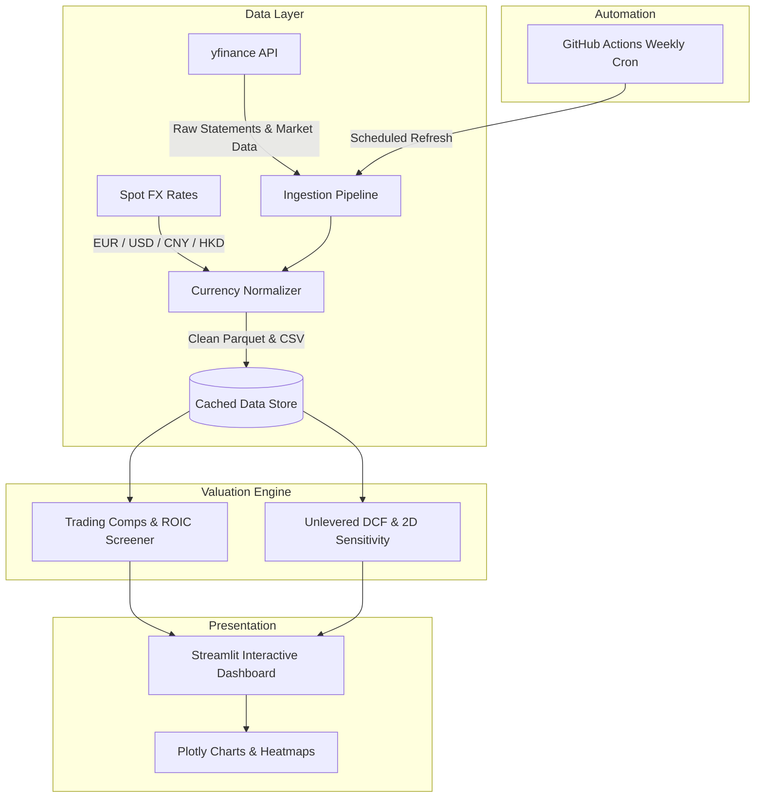

# Sino-European Automotive Peer Group & Valuation Dashboard

**Automated Equity Research Screener, Cross-Currency Trading Comps & DCF Sensitivity Engine**

[](https://www.python.org/)
[](https://streamlit.io/)
[](LICENSE)

---

## 1. Executive Summary & Investment Thesis

The global automotive sector is undergoing a structural bifurcation between **legacy European OEMs** defending high-margin ICE/luxury franchises while funding capital-intensive BEV platform transitions, and **Chinese NEV leaders** leveraging vertical battery integration and software-defined vehicle (SDV) speed to capture global market share.

This repository delivers an **institutional-grade, automated financial analytics & valuation platform** designed for **M&A Advisory, Equity Research, Private Equity, and Corporate Strategy** workflows. It eliminates manual spreadsheet updates by programmatically ingesting multi-exchange financial statements (`XETRA`, `HKEX`, `NYSE/NASDAQ`), normalizing trading vs. reporting currencies (`EUR / USD / CNY / HKD`), computing standardized capital efficiency and leverage ratios, and running interactive **Unlevered DCF & 2D Sensitivity Matrices**.

### Key Analytical Capabilities
1. **Cross-Exchange & Cross-Currency Normalization**: Automatically reconciles dual-currency issuers (e.g., `1211.HK` BYD trading in `HKD` while reporting in `CNY`; `LI` & `NIO` trading in `USD` while reporting in `CNY`) into a unified `EUR`, `USD`, or `CNY` pivot via live spot FX.
2. **Institutional Trading Comps**: Side-by-side benchmarking of **EBITDA Margin**, **EBIT Margin**, **R&D Intensity (% of Sales)**, **ROIC**, **Net Debt / EBITDA**, **EV/EBITDA**, **EV/Sales**, and **Forward P/E**.
3. **Interactive Unlevered DCF & 2D Sensitivity Heatmap**: 5-year FCFF projection engine with CAPM-estimated WACC, dual Terminal Value methodologies (Gordon Growth & Exit EV/EBITDA Multiple), and an interactive WACC vs. Terminal Growth Rate ($g$) sensitivity matrix.
4. **Extensible Phase-2 Architecture (Tier-1 Suppliers)**: Built around an abstract `BaseIngestionPipeline` and modular `peers_config.json` to seamlessly activate European & Chinese Tier-1 suppliers (`Continental`, `Schaeffler`, `Valeo`, `Joyson`, `Tuopu`).

---

## 2. Coverage Universe (Phase 1: OEMs)

| Region | Company | Ticker | Trading / Reporting CCY | Strategic Positioning |
| :--- | :--- | :--- | :--- | :--- |
| **Europe** | Volkswagen AG | `VOW3.DE` | EUR / EUR | Mass & premium conglomerate; EV transition & deep value multiple |
| **Europe** | BMW Group | `BMW.DE` | EUR / EUR | Premium OEM; disciplined capital efficiency & Neue Klasse ramp |
| **Europe** | Mercedes-Benz Group | `MBG.DE` | EUR / EUR | Top-End Luxury pricing resilience & strong FCF conversion |
| **Europe** | Stellantis N.V. | `STLAM.MI` | EUR / EUR | Multi-brand platform synergies & shareholder capital return |
| **China** | BYD Company Ltd. | `1211.HK` | HKD / CNY | Vertically integrated NEV & battery cost leader |
| **China** | Geely Automobile | `0175.HK` | HKD / CNY | Multi-brand SEA modular architecture & global expansion |
| **China** | Li Auto Inc. | `LI` | USD / CNY | EREV profitability pioneer in premium family SUVs |
| **China** | NIO Inc. | `NIO` | USD / CNY | Premium smart BEV & Battery-as-a-Service (BaaS) ecosystem |
| **Global Benchmark** | Tesla, Inc. | `TSLA` | USD / USD | Pure-play EV, energy storage & autonomy valuation benchmark |

---

## 3. System Architecture



---

## 4. Valuation & Financial Methodology

- **Enterprise Value (EV)**:
  $$\text{EV} = \text{Market Cap} + \text{Total Debt} + \text{Minority Interest} - \text{Cash and Short-Term Investments}$$
- **Return on Invested Capital (ROIC)**:
  $$\text{ROIC} = \frac{\text{EBIT} \times (1 - \text{Effective Tax Rate})}{\text{Total Debt} + \text{Total Equity} - \text{Cash}}$$
- **Unlevered Free Cash Flow (FCFF)**:
  $$\text{FCFF}_t = \text{NOPAT}_t + \text{D/A}_t - \text{CapEx}_t - \Delta\text{NWC}_t$$
- **Weighted Average Cost of Capital (WACC)**:
  $$\text{WACC} = \frac{E}{E+D}(R_f + \beta \cdot \text{ERP}) + \frac{D}{E+D} R_d (1 - T)$$

---

## 5. Quickstart & Local Execution

### 1. Clone & Install Dependencies
```bash
git clone https://github.com/data-gao/Automotive-Automated-Financial-Metrics-Valuation-Dashboard.git
cd Automotive-Automated-Financial-Metrics-Valuation-Dashboard
python -m venv .venv
source .venv/bin/activate  # On Windows: .venv\Scripts\activate
pip install -r requirements.txt
```

### 2. Run Data Ingestion Pipeline
Fetch live financial statements, market caps, and spot FX rates into `data/processed/`:
```bash
python -m src.ingestion
# Optional: Include Phase-2 Tier-1 automotive suppliers
python -m src.ingestion --include-tier1
```

### 3. Launch Interactive Streamlit Dashboard
```bash
streamlit run app.py
```

### 4. Run Unit Tests
```bash
pytest -v
```

---

## 6. Deployment (Streamlit Community Cloud)
1. Push this repository to GitHub (`.github/workflows/update_data.yml` will automatically keep `data/processed/` updated weekly).
2. Go to [share.streamlit.io](https://share.streamlit.io/), connect your GitHub repository, and set the main file path to `app.py`.
3. Click **Deploy** — cold starts load instantaneously from the cached Parquet snapshots, with an in-app button for on-demand live refreshes.

---

## Disclaimer
*This project is built strictly for educational, portfolio demonstration, and financial analysis purposes. It does not constitute investment advice or a solicitation to buy or sell any securities.*
